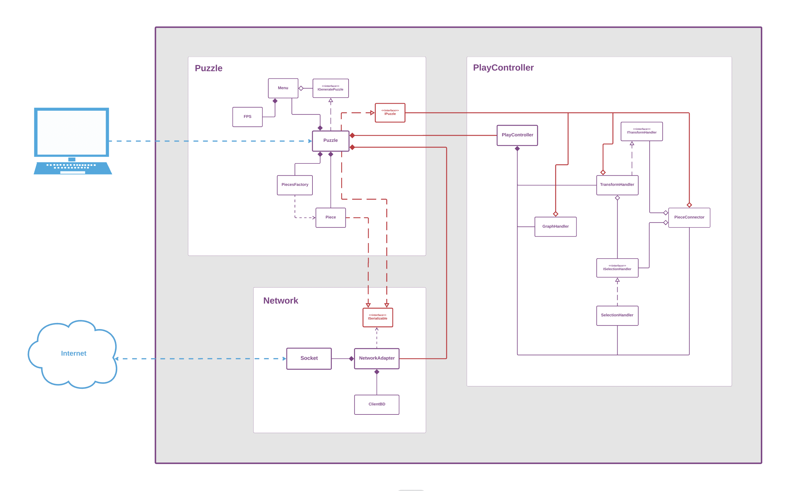

# Puzzelin

An online puzzle for family and friends. This is still a work in progess but the app should be relatively stable and playable in Chrome, Safari and on iPad or mobile devices.

**[Try it out!](https://puzzelin.se)**

## Browser & Device Compatibility

Mouse (+Keyboard) or Touch is all fully supported.

🟢 **Chrome** - Good FPS;\
🟢 **Safari** - Good FPS;\
🟢 **iPad** - Good FPS, won't load images sometimes;\
🟢 **Mobile** - Good FPS, screen size not ideal;\
🟡 **Edge** - To be determined;\
🔴 **Firefox** - Really bad FPS;

## Installation

Run `bun install` followed by `bun dev` (with `PEXELS_API_KEY` in `.env.local`) and open http://localhost:3000.

## About the code

- **Frontend Stack:** [React, Tailwind, Typescript, P5.js];
- **Backend Stack:** Bun server with SQLite and WebSockets for realtime collaboration;
- **Paradigm:** Mostly OOP, with some helper functions;
- **Modules:** Configured to run "module-less";
- **Class Diagram:** Slightly outdated, but communicates the gernal architecture of the codebase:

## Links used to solve certain problems:

- [Determine if a point is inside a curve](https://scicomp.stackexchange.com/questions/16343/how-to-determine-if-a-point-is-outside-or-inside-a-curve#:~:text=There's%20a%20simple%20test%20to,region%3B%20otherwise%2C%20it's%20outside.)
- [Fill p5 shape with image](https://stackoverflow.com/questions/60179313/how-to-fill-p5-js-shape-with-an-image)
- [Find Bezier Points](https://stackoverflow.com/questions/7715788/find-bezier-control-points-for-curve-passing-through-n-points)
- [Zoom effect with p5](https://stackoverflow.com/questions/57131714/create-zoom-effect-with-p5-js)
- [Rotate points around origin](https://stackoverflow.com/questions/45357715/how-to-rotate-point-around-another-one/45360970)
- [Transformations in p5](https://genekogan.com/code/p5js-transformations/)
